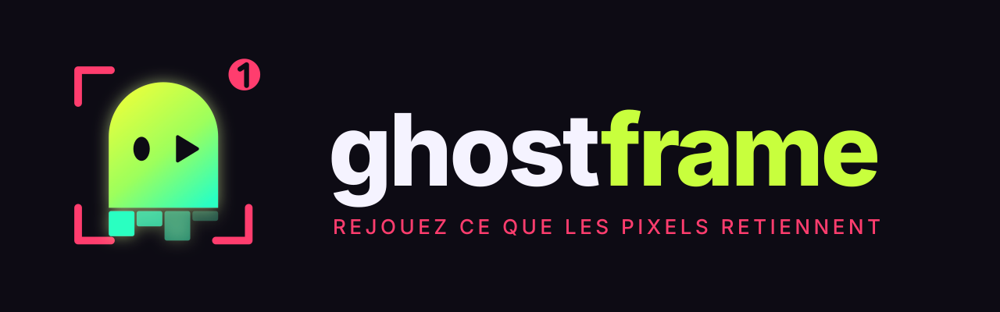
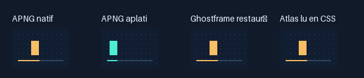

# Project Ghostframe

[English](README.md) · Français · [Guide Replay](web/replay/README.md)



**[Ghostframe Replay](web/replay/README.md)** transforme une capture d’écran annotée en JPEG rejouable. L’éditeur et le lecteur fonctionnent dans le navigateur, sans envoi de fichier. Le rapport décrit les essais de recompression et les limites du prototype.

[Présentation illustrée et logos](docs/media/README.md) · [Prépublication GFS2 et fichiers de reproduction](https://zenodo.org/records/24490921)

## Installation

| Format | Utilisation | Prérequis |
| --- | --- | --- |
| HTML autonome | Ouvrir l’éditeur et rejouer les étapes | Un navigateur moderne |
| npm ou npx, paquet `@residual-labs/ghostframe-replay` | Servir Replay en local, générer son HTML ou intégrer le codec JavaScript | Node.js 22+ |
| Python, paquet `project-ghostframe` | Créer, inspecter et restaurer des PNG/APNG en ligne de commande ou via `import ghostframe` | Python 3.10+ |

Avec Node.js 22+, lancer Replay depuis un dossier extérieur au clone. Ouvrir l’adresse locale affichée et arrêter le serveur avec `Ctrl+C`. Le serveur écoute sur `127.0.0.1`.

```sh
npx --yes --package @residual-labs/ghostframe-replay ghostframe-replay
```

Utiliser `npm install @residual-labs/ghostframe-replay` pour ajouter le codec à un projet Node.js. Depuis ce projet, `npx ghostframe-replay build sortie.html` génère l’HTML autonome. Le fichier HTML est aussi disponible dans les [versions GitHub](https://github.com/zakariagharzouli/project-ghostframe/releases).

Depuis le clone, `node web/replay/cli.cjs --help` affiche les options. On peut aussi générer l’HTML directement.

```sh
node web/replay/build.cjs ghostframe-replay.html
```

Pour les outils APNG, installer `project-ghostframe` depuis PyPI, de préférence dans un environnement virtuel. Le [guide Python](docs/python-package.md) explique aussi l’installation depuis les sources.

```sh
python -m pip install project-ghostframe
python -m ghostframe --help
```

Depuis le clone du dépôt, inspecter un exemple fourni.

```sh
python -m ghostframe inspect evidence/inputs/apng-a.png
```

L’éditeur Replay a une interface en français. Le paquet Python contient la commande APNG et le module `ghostframe`. Les scripts de recherche et les jeux de tests restent dans le dépôt.

## Recherche sur les formats d’image

Prototype de Residual Labs pour mesurer ce qu’une chaîne de traitement PNG conserve d’une animation. Le projet fournit deux chemins de récupération et vérifie leur sortie dans le navigateur à partir de captures du rendu.

La [phase 2](docs/phase2.md) ajoute des rectangles APNG, un transcodage WebP animé, une capsule raster à parité et un banc comparatif Pillow/OpenCV. Voir le [rapport Phase 2](docs/phase2-results.md) et la [matrice mesurée](evidence/phase2/matrice.md).



Le GIF ci-dessus regroupe les zones de quatre surfaces capturées dans Chrome. La [démonstration HTML](evidence/demo.html) utilise les PNG de l’expérience et fonctionne hors ligne une fois téléchargée. Ouvrir le fichier dans un navigateur moderne.

## Résultats

- **APNG natif.** Un service qui transmet les octets ou réencode toutes les trames peut servir un PNG animé en `image/png`. Dans le banc mesuré, Chrome a affiché les quatre trames dans `` et dans un arrière-plan CSS. En redessinant exactement la même ressource via `drawImage`, le canvas est resté fixe.
- **Ghostframe.** Le bloc PNG privé `gfRs` a survécu à un réencodage qui supprimait les blocs APNG et conservait ce bloc auxiliaire. L’outil serveur a reconstitué les quatre trames, leurs délais et la boucle, puis Chrome a lu l’APNG restauré automatiquement.
- **Atlas.** Les quatre trames ont survécu sous forme de pixels après réencodage statique sans perte. Une page qui contrôle son CSS peut les afficher successivement à partir du même PNG. Le redimensionnement testé a fait échouer la restauration exacte.
- **Limite.** Deux APNG différents ayant le même raster par défaut ont produit le même PNG aplati octet pour octet. Un client qui ne reçoit que cette sortie ne peut savoir laquelle des deux animations restituer.

## Reproduire

Le générateur et les tests utilisent Python 3.10+ et Pillow. Le banc visuel utilise aussi Node.js 22+ et un navigateur Chromium installé. La page de démonstration utilise uniquement le navigateur.

```sh
python -m pip install -r requirements.txt
python -m unittest discover -s tests -v
python lab.py
```

`python lab.py --browser <chemin>` sélectionne un exécutable. `python lab.py --no-browser` exécute la génération et les parcours HTTP quand aucun Chromium n’est disponible. Le banc écoute sur `127.0.0.1` et doit pouvoir ouvrir des connexions locales.

```sh
python ghostframe.py encode test.png run/inputs/frame-0.png run/inputs/frame-1.png --delay 350
python ghostframe.py inspect test.png
python ghostframe.py recover run/processed/ghostframe-safe-copy.png restored.png
python ghostframe.py from-atlas run/processed/atlas-raster.png run/inputs/atlas.json restored-atlas.png
```

`encode` utilise le mode `dual` par défaut. `--mode apng` écrit un APNG standard seul et `--mode atlas` écrit un PNG statique vertical accompagné de son manifeste JSON. `--plays 0` indique une boucle infinie.

Pour produire les distributions, `npm pack` génère l’archive npm. Dans l’environnement de construction Python, installer `build` avec `python -m pip install build`, puis exécuter `python -m build` pour créer l’archive source et la roue dans `dist/`.

Le [guide de publication](docs/release.md#français) donne les réglages des registres et les commandes d’installation après publication.

## Documentation et preuves

- [Guide et format Ghostframe Replay](web/replay/README.md)
- [Banc de comparaison à surface égale](web/replay/benchmark.md) et [validation ScreenSpot-Pro](web/replay/holdout.md)
- [Programme de recherche et critères de réfutation](docs/programme.md)
- [Spécification de l’encodeur, bloc binaire et protocole du banc](docs/technique.md)
- [Rapport des expériences et limites](docs/rapport.md)
- [Essais de diffusion sur les plateformes, phase 3](https://github.com/zakariagharzouli/project-ghostframe/pull/2)
- [Exemples PNG et traces](evidence/)

Licence [MIT](LICENSE).
