# Project Ghostframe

English · [Français](README.fr.md) · [Replay technical guide](web/replay/README.en.md)

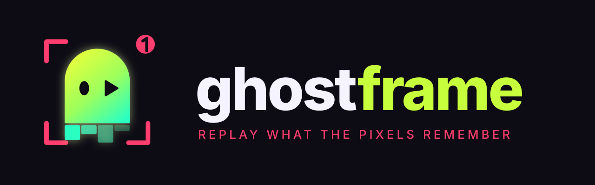

Ghostframe is an open-source Residual Labs project about recovering useful motion and annotations after image processing. **Ghostframe Replay** turns an annotated screenshot into a JPEG that can replay the steps in a browser. The PNG/APNG tools are a separate part of the project for generating, inspecting, and recovering animations.

[Visual walkthrough and logos](https://github.com/zakariagharzouli/project-ghostframe/tree/main/docs/media) · [GFS2 preprint and reproducibility files](https://zenodo.org/records/24490921)

## Install and try

| Distribution | Use it for | Requirements |
| --- | --- | --- |
| Standalone HTML | Edit and replay a JPEG in the browser | A modern browser |
| npm or npx package `@residual-labs/ghostframe-replay` | Serve Replay locally, build the HTML, or use the JavaScript codec | Node.js 22+ |
| Python package `project-ghostframe` | Generate, inspect, and recover PNG/APNG from the terminal or `import ghostframe` | Python 3.10+ |

To start Replay with Node.js 22+, run this from outside the source checkout. Open the local URL it prints. Press `Ctrl+C` to stop the server. It listens only on `127.0.0.1`.

```sh
npx --yes --package @residual-labs/ghostframe-replay ghostframe-replay
```

Use `npm install @residual-labs/ghostframe-replay` to add the codec to a Node.js project. Run `npx ghostframe-replay build output.html` from that project to produce the standalone page. You can also download the HTML from the [GitHub releases](https://github.com/zakariagharzouli/project-ghostframe/releases).

From the source checkout, use `node web/replay/cli.cjs --help` or build the HTML directly.

```sh
node web/replay/build.cjs ghostframe-replay.html
```

For PNG/APNG tools, install the Python package from PyPI. A virtual environment keeps the command and dependencies isolated. The [Python package guide](docs/python-package.md) also covers installing from source.

```sh
python -m pip install project-ghostframe
python -m ghostframe --help
```

In the source checkout, inspect a supplied example.

```sh
python -m ghostframe inspect evidence/inputs/apng-a.png
```

Replay's browser interface is in French. The Python package contains the APNG command and `ghostframe` module. The repository also contains the research harnesses and evidence.

## What Replay does

Import, paste, or drop a screenshot, then place ordered markers with optional notes and durations. Export a JPEG and open it in **Rejouer** to play the steps. Replay stores the sequence in a visible grayscale strip. The editor and reader process images inside the browser.

The [English guide](web/replay/README.en.md) documents the format, reproduction commands, and measured limits. The [French guide](web/replay/README.md) includes the complete reproduction instructions.

## Ghostframe Replay in pictures

The ten illustrations are in French. The English alternative text identifies each step and experiment. The ScreenSpot-Pro chart shows an experimental two-pass reader evaluated under the preprint's local protocol. The distributed app uses the ordinary reader.

| Illustration | Illustration |
| --- | --- |
| 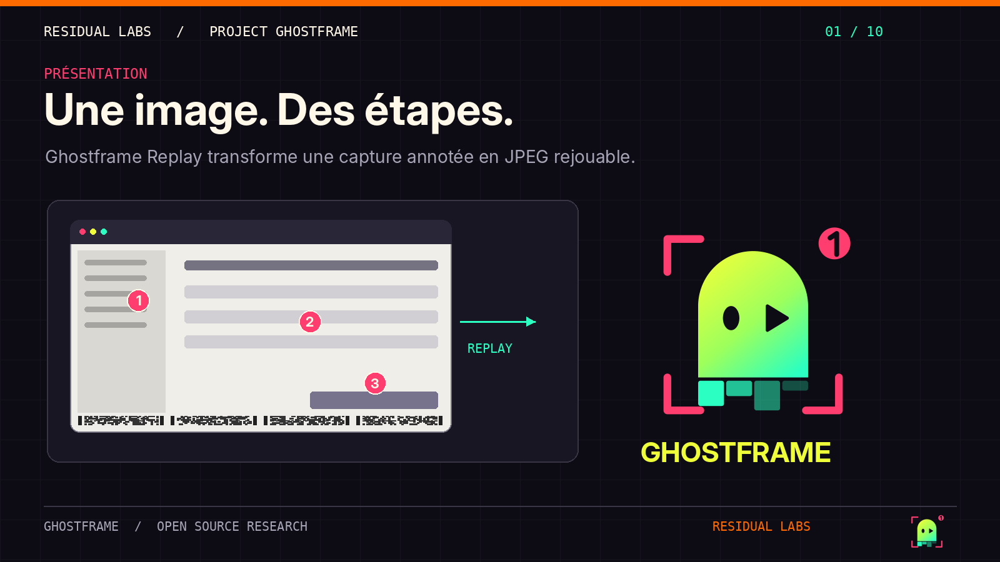 | 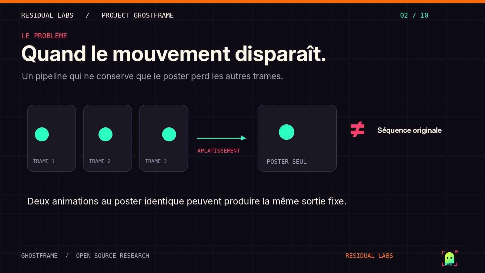 |
| 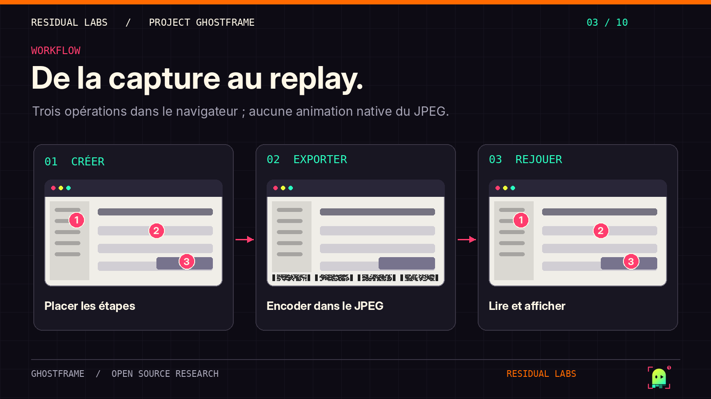 | 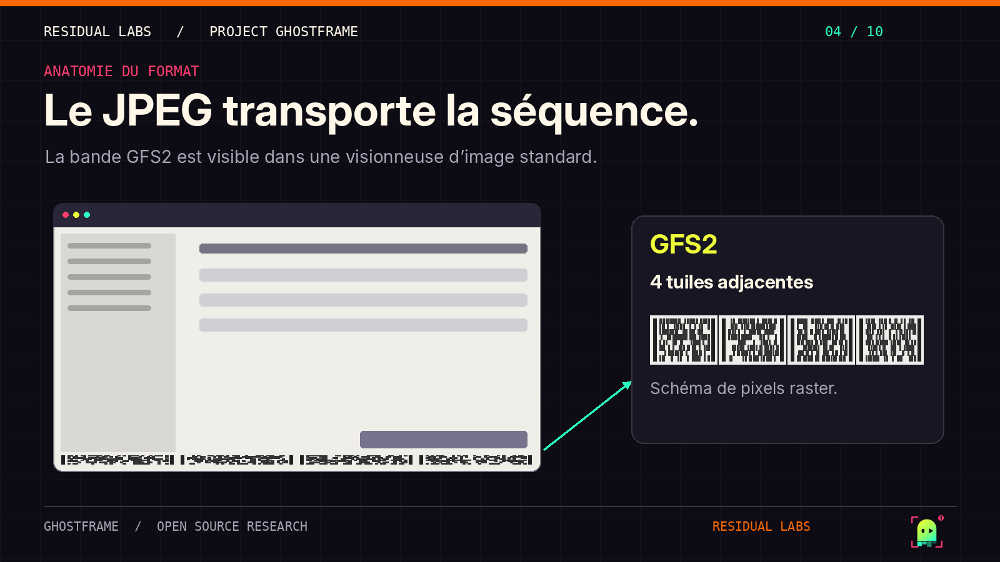 |
| 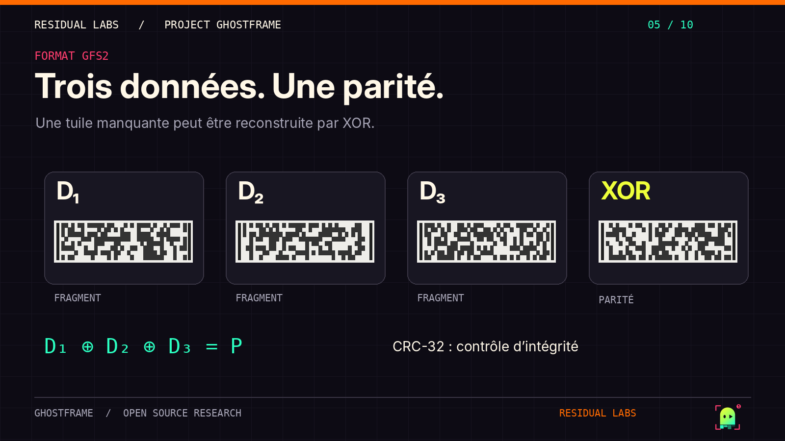 | 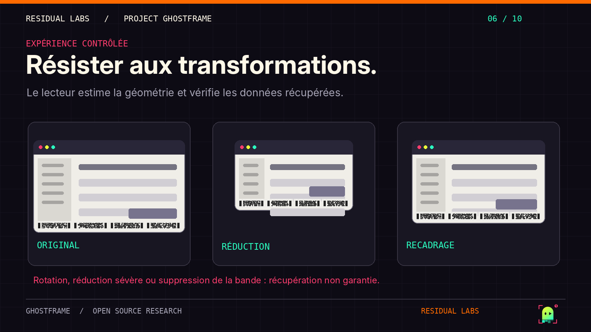 |
| 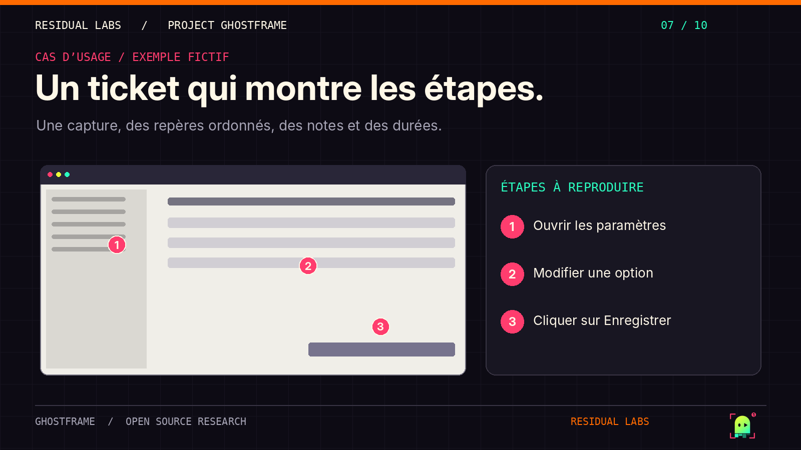 | 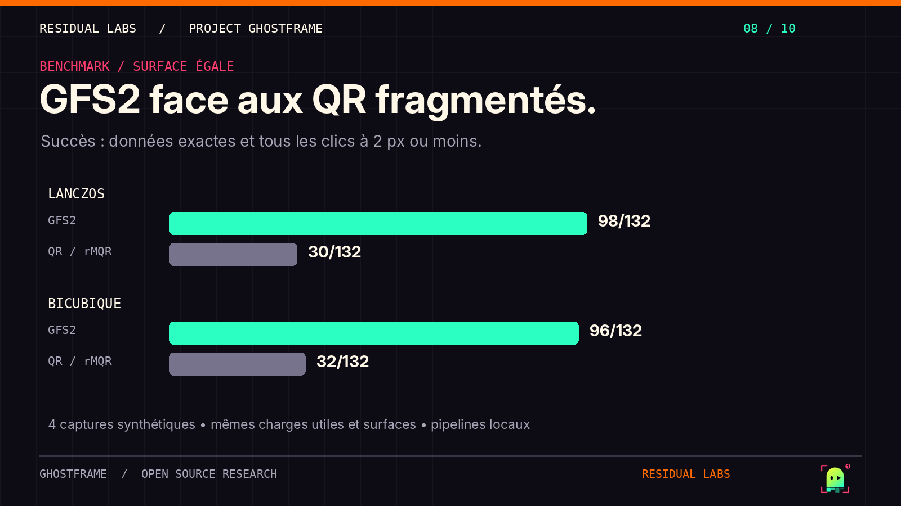 |
| 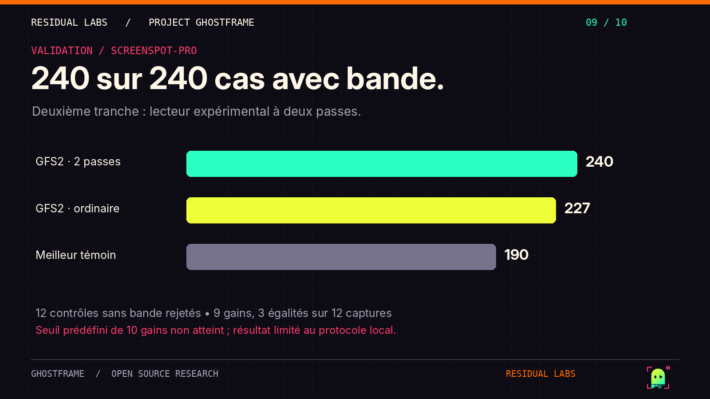 | 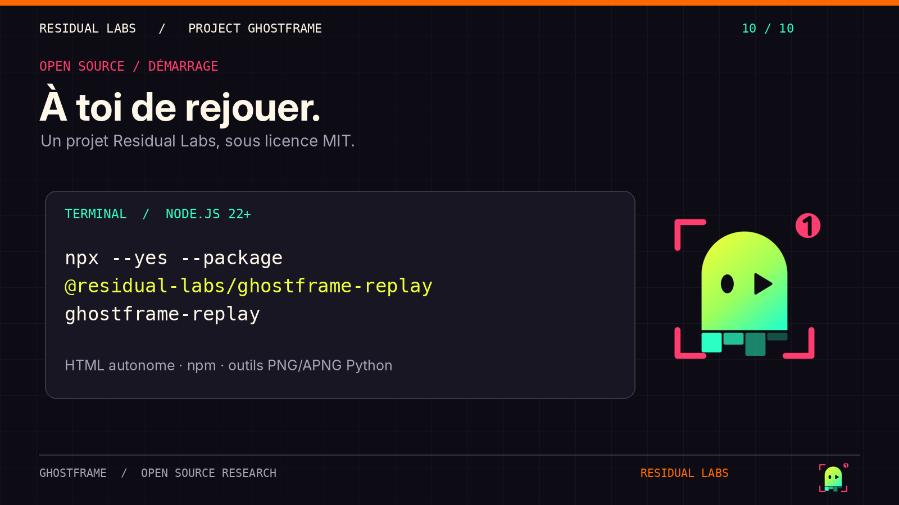 |

## Research and evidence

- [PNG/APNG project plan](docs/programme.md), [technical specification](docs/technique.md), and [initial results](docs/rapport.md) in French.
- [Phase 2 results](docs/phase2-results.md) on sparse APNG, WebP conversion, and visual parity capsules.
- [Platform delivery experiments](https://github.com/zakariagharzouli/project-ghostframe/pull/2), including the flattened public Instagram avatar measurement.
- [Equal-area comparison](web/replay/benchmark.md) and [ScreenSpot-Pro validation](web/replay/holdout.md) for Replay, with an English summary in the [technical guide](web/replay/README.en.md#research-results).
- [PNG examples and playback evidence](evidence/). The [browser demo](evidence/demo.html) illustrates the original PNG/APNG research.

In the original lab, an animation-aware decoder displayed APNG frames when the pipeline preserved them. A poster-only pipeline produced identical output from two different animations with the same poster. Replay tackles a different case by explicitly storing the annotations in visible raster pixels. A Ghostframe-compatible reader extracts them and plays the steps over the screenshot.

## Develop and verify

```sh
npm test
python -m pip install -r requirements.txt
python -m unittest discover -s tests -v
python lab.py --no-browser
```

Run `python lab.py` for the original Chromium rendering measurements, or pass `--browser` with an executable path. The comparative Replay benchmark and holdout use the separate requirements and commands listed in their reports.

For distribution builds, `npm pack` creates the npm archive. Use `python -m pip install build` in your build environment, then `python -m build` to generate the Python source distribution and wheel in `dist/`.

The [release guide](docs/release.md#english) lists the registry setup and install commands for published packages.

[MIT license](LICENSE).
