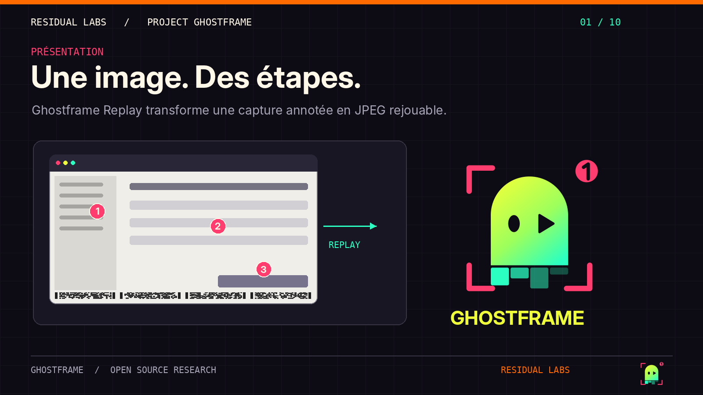
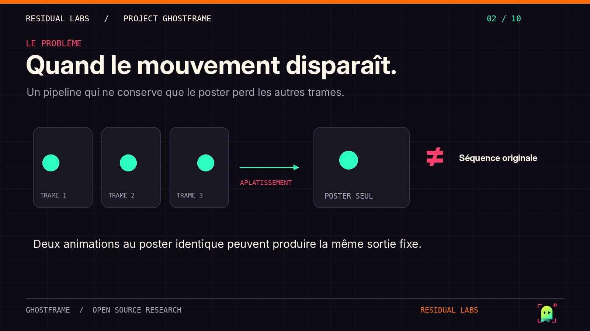
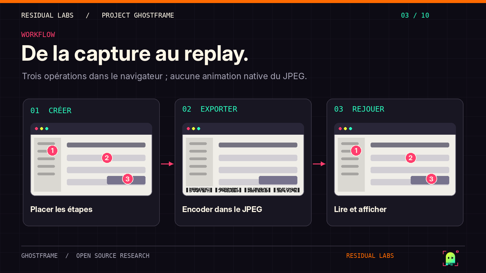
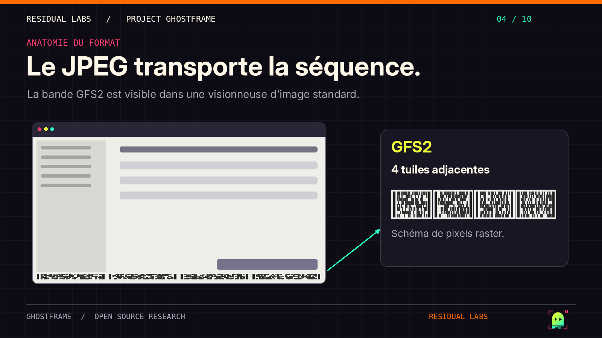
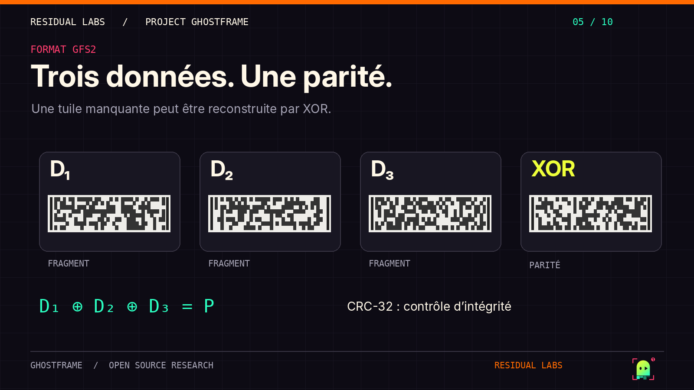
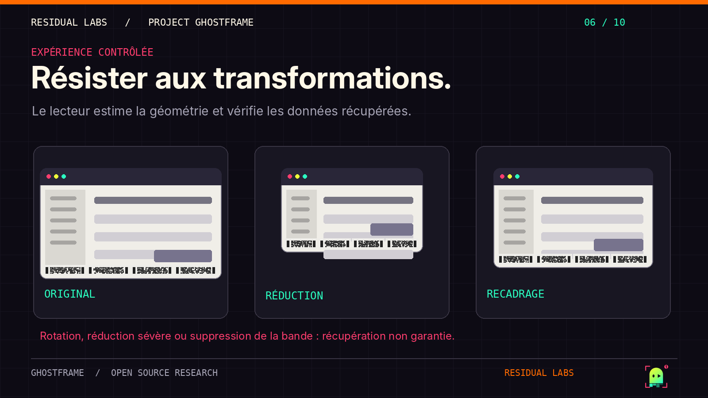
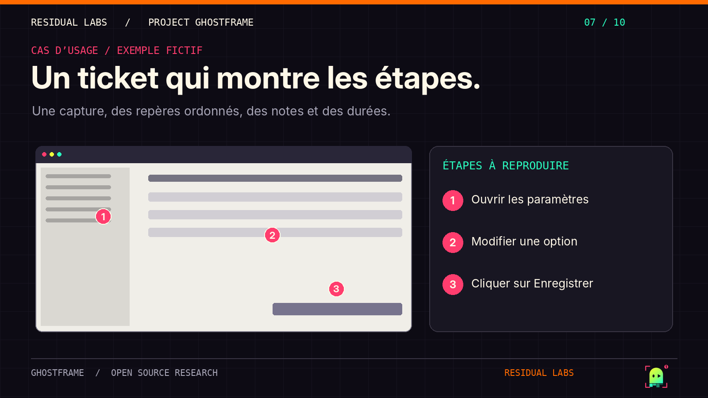
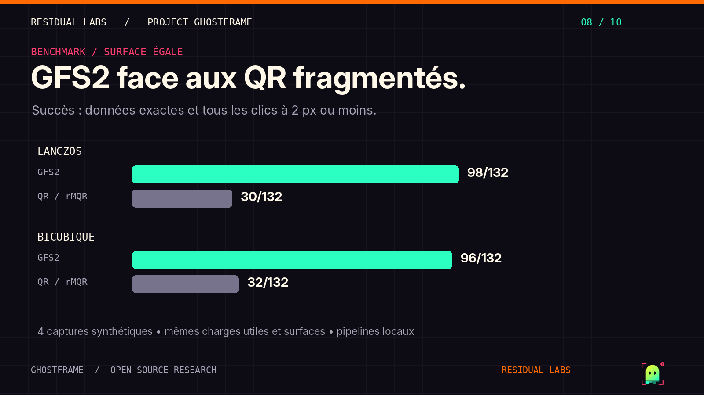
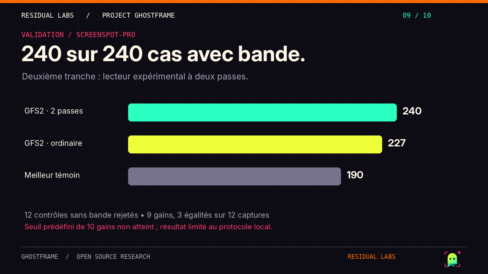
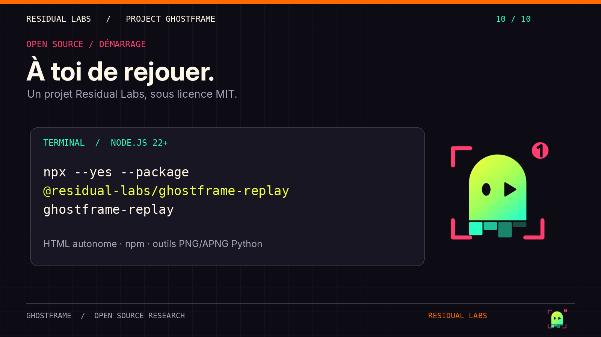

# Ghostframe Replay en images

[English README](../../README.md) · [Documentation française](../../README.fr.md) · [Prépublication / Preprint](https://zenodo.org/records/24490921)

Les dix visuels de Residual Labs présentent le parcours dans le navigateur, le format GFS2 et les essais de récupération. Les légendes anglaises résument le contenu des visuels en français.

The ten illustrations cover browser replay, the GFS2 format, and recovery experiments. The English captions summarize the French-language artwork.

| Visuel / Illustration | Visuel / Illustration |
| --- | --- |
|  |  |
|  |  |
|  |  |
|  |  |
|  |  |

Le graphique ScreenSpot-Pro présente le lecteur **expérimental à deux passes** sur la deuxième tranche. La version publique utilise le lecteur ordinaire. Le seuil prédéfini de dix gains sur douze captures est resté hors d’atteinte. [Protocole et résultats](../../web/replay/holdout.md)

The ScreenSpot-Pro chart shows the **experimental two-pass reader** on the second split. The public release uses the ordinary reader. The predefined target of ten wins over twelve screenshots was unmet. [Protocol and results](../../web/replay/holdout.md)

## Logos

[Logo français](ghostframe-logo-fr.svg) · [English logo](ghostframe-logo.svg) · [Square icon](ghostframe-icon.svg) · [Standalone mark](ghostframe-mark.svg)
