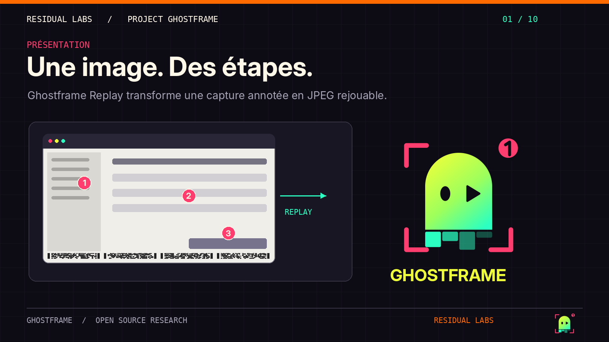
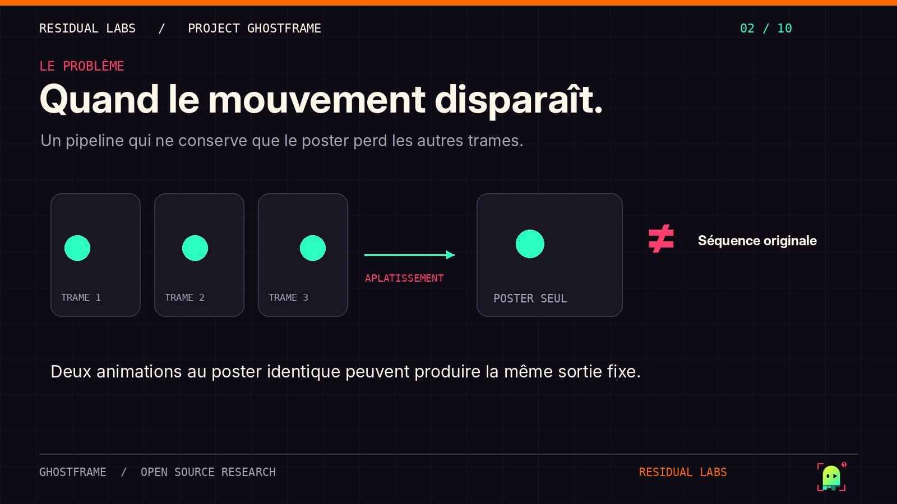
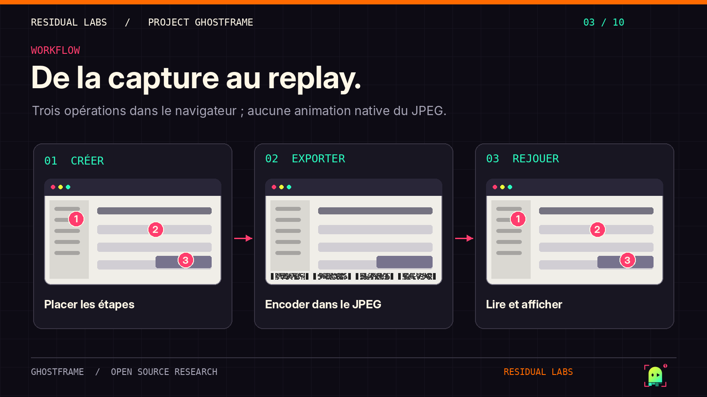
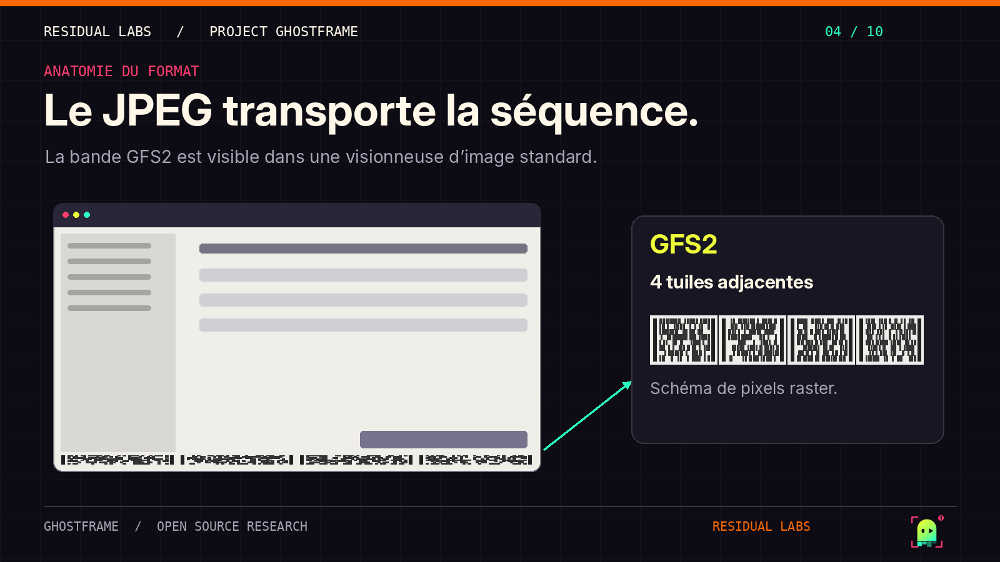
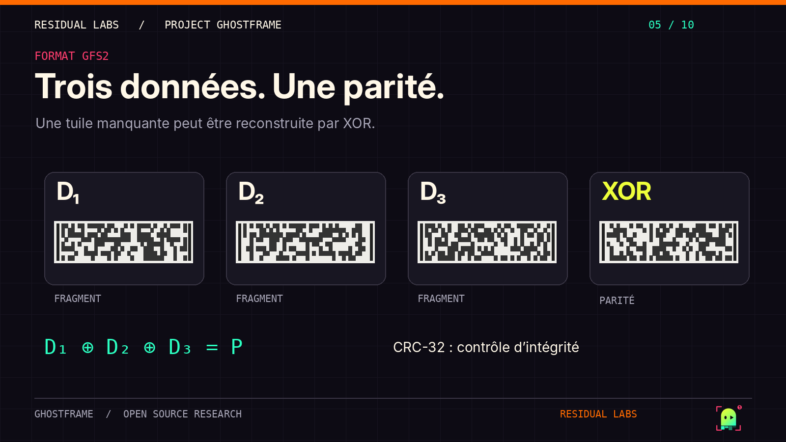
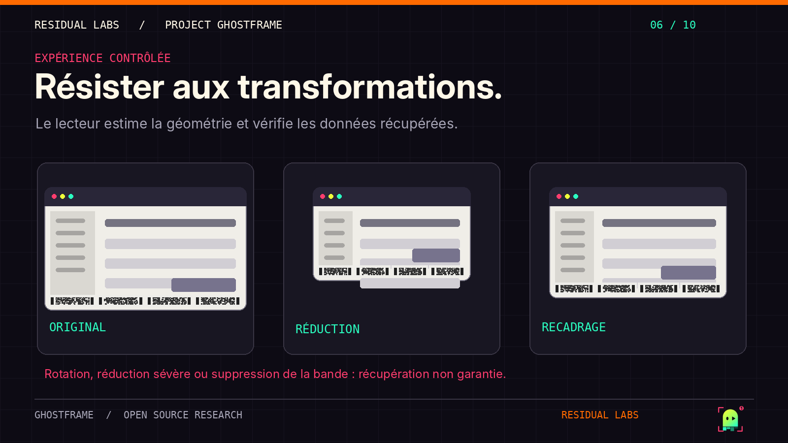
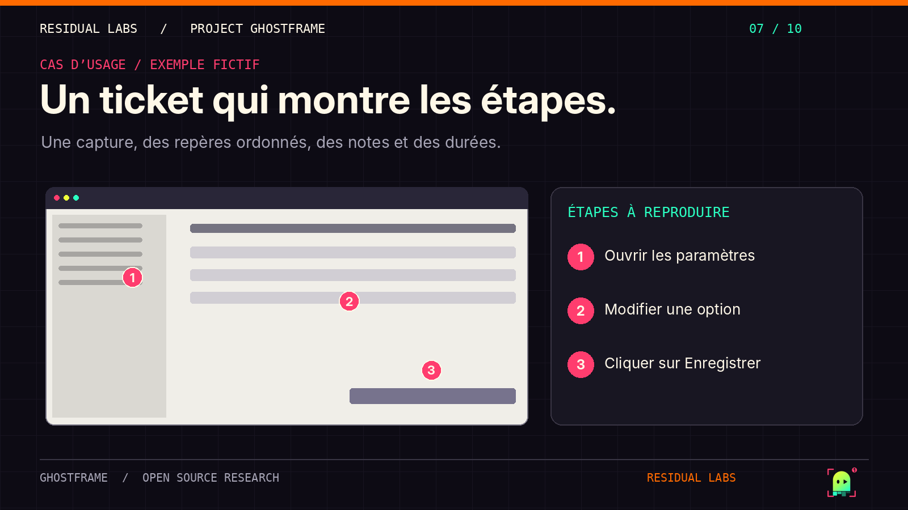
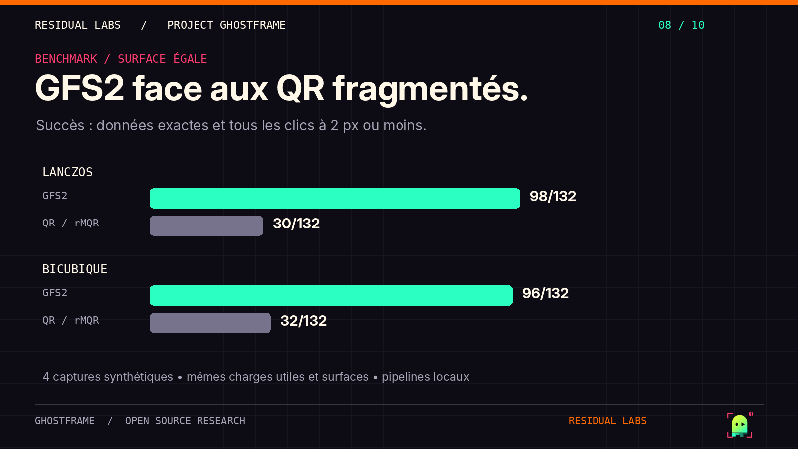
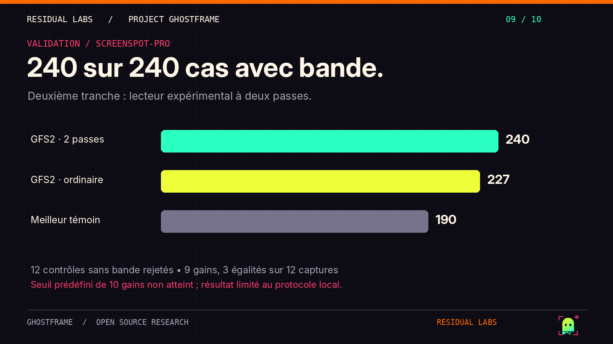
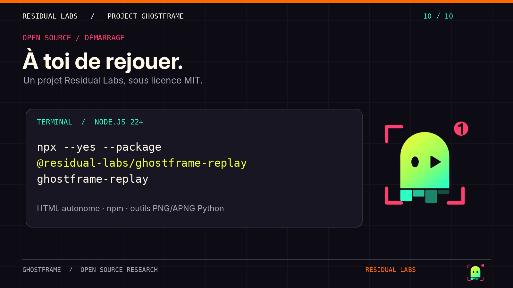

# Project Ghostframe for Python

English · [Français](#français) · [Residual Labs](https://residual-labs.fr/) · [Source code](https://github.com/zakariagharzouli/project-ghostframe)

`project-ghostframe` provides the `ghostframe` command and importable `ghostframe` module. It generates APNG files, inspects frame and archive metadata, and restores supported animations from a Ghostframe archive or atlas. It requires Python 3.10+ and Pillow. Ghostframe Replay is distributed as a standalone HTML app and a separate npm package.

Install from PyPI, preferably inside a virtual environment.

```sh
python -m pip install project-ghostframe
```

To install from a source checkout, use `python -m pip install .`. For the example below, provide two PNG frames of the same size, such as the [example inputs](https://github.com/zakariagharzouli/project-ghostframe/tree/feature/ghostframe-replay/evidence/inputs).

```sh
python -m ghostframe encode animation.png frame-0.png frame-1.png --delay 350
python -m ghostframe inspect animation.png
python -m ghostframe recover animation.png recovered.png
```

The default `dual` mode writes an APNG with a Ghostframe archive. `--mode apng` writes standard APNG frames, and `--mode atlas` produces a static PNG and a JSON manifest for `python -m ghostframe from-atlas`. `--sparse` uses delta rectangles for APNG or dual mode. Run `python -m ghostframe --help` for all commands. You can shorten `python -m ghostframe` to `ghostframe` when the installed console command is on your `PATH`.

## Français

`project-ghostframe` fournit la commande `ghostframe` et le module Python du même nom. Il génère des APNG, inspecte les métadonnées des trames et restaure les animations prises en charge depuis une archive Ghostframe ou un atlas. Python 3.10+ et Pillow sont nécessaires. Ghostframe Replay est distribué séparément en HTML et via npm.

Installer le paquet avec `python -m pip install project-ghostframe`, de préférence dans un environnement virtuel. Depuis un clone du dépôt, utiliser `python -m pip install .`. L’exemple ci-dessus utilise deux PNG de même taille, comme les [trames fournies dans le dépôt](https://github.com/zakariagharzouli/project-ghostframe/tree/feature/ghostframe-replay/evidence/inputs). `python -m ghostframe --help` affiche toutes les commandes. Le raccourci `ghostframe` est disponible si la commande installée est dans le `PATH`.

Le mode par défaut `dual` écrit un APNG avec archive Ghostframe. `--mode apng` écrit un APNG standard. `--mode atlas` fournit une image PNG fixe et un manifeste JSON pour `python -m ghostframe from-atlas`. `--sparse` utilise des rectangles de différences en mode APNG ou dual.

## Ghostframe Replay en images

Ces visuels présentent le lecteur d’annotations JPEG du projet. Il est disponible en [HTML autonome](https://github.com/zakariagharzouli/project-ghostframe/releases/download/v0.1.1/ghostframe-replay.html) et [sur npm](https://www.npmjs.com/package/@residual-labs/ghostframe-replay). Le paquet Python fournit les commandes PNG/APNG décrites ci-dessus.

Le graphique ScreenSpot-Pro présente le lecteur expérimental à deux passes selon le protocole local de la [prépublication](https://zenodo.org/records/24490921). La version distribuée de Replay utilise le lecteur ordinaire. [Galerie et logos](https://github.com/zakariagharzouli/project-ghostframe/tree/main/docs/media)

| Visuel | Visuel |
| --- | --- |
|  |  |
|  |  |
|  |  |
|  |  |
|  |  |
